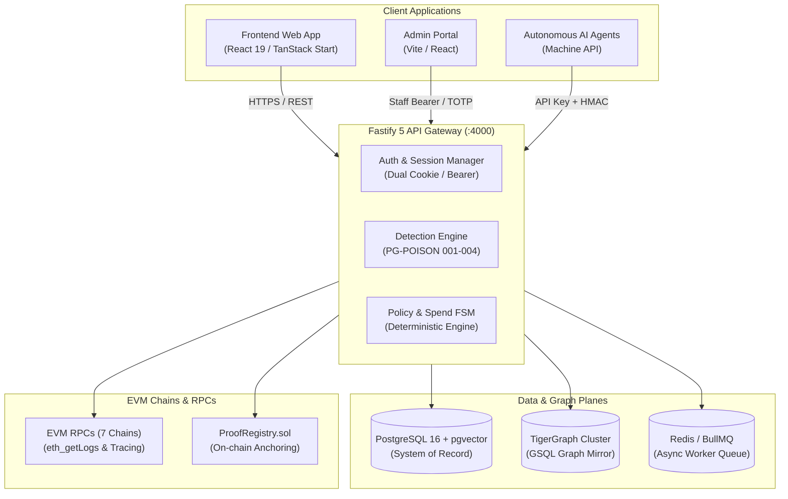

# 🛡️ PoisonGuard

> **Self-Custody Threat Detection, Rogue Allowance Auditor & Graph Intelligence Engine for EVM Wallets & Autonomous AI Agents.**

[](https://github.com/Pritam9078/POISION_GUARD/actions/workflows/ci.yml)
[](https://nodejs.org/)
[](https://fastify.dev/)
[](https://react.dev/)
[](https://www.tigergraph.com/)
[](LICENSE)

---

## 🌐 Live Deployments

| Component | Live Production URL | Notes |
| :--- | :--- | :--- |
| **User Web Application** | [poisonguard-three.vercel.app](https://poisonguard-three.vercel.app) | Public Scanner, Guard Workspace, Revoke Portal |
| **Mirror Deployment** | [poisonguard-steel.vercel.app](https://poisonguard-steel.vercel.app) | Staging / Fallback deployment |
| **Staff Admin Portal** | [poisionguardadmin.vercel.app](https://poisionguardadmin.vercel.app) | Tenant monitoring, audit chain, staff RBAC |
| **Backend REST API** | [poisonguard-backend.onrender.com](https://poisonguard-backend.onrender.com) | Fastify 5 + TigerGraph + PostgreSQL |
| **Interactive OpenAPI Docs** | [poisonguard-backend.onrender.com/api/docs](https://poisonguard-backend.onrender.com/api/docs) | Swagger UI interactive sandbox |

---

## 🎯 The Problem

1. **Address Poisoning Epidemic**: Attackers generate vanity addresses matching the first 4–6 and last 4–6 characters of legitimate counterparties, sending `0`-value token transfers to target wallets. Users copying transaction history paste the poisoned address and lose funds.
2. **Rogue Token Approvals & Drainers**: Users unintentionally grant `unlimited` token allowances to compromised or unverified smart contracts that drain balances days or weeks later.
3. **Autonomous AI Agent Risks**: Autonomous Web3 AI agents executing on-chain actions lack deterministic governance, guardrails, and human-in-the-loop review.

---

## ⚡ What PoisonGuard Does

- 🔍 **Real-Time Address Poisoning Detection**: Evaluates transaction history across 7 EVM networks (Ethereum, Base, Arbitrum, Optimism, Polygon, BSC, Sepolia) using deterministic heuristic and graph algorithms (`PG-POISON-001` through `PG-POISON-004`).
- 🕸️ **TigerGraph Counterparty Intelligence**: Leverages TigerGraph GSQL graph mirror (`pg_neighbors`) to identify 1-hop counterparty clusters, sybil dust distribution networks, and poisoning campaigns.
- 🔐 **Safe Self-Custody Token Revocation**: Inspects active allowances on-chain and generates minimal zero-allowance transactions without requesting elevated permissions.
- 🤖 **Agent Guardrails & Spend Policies**: Per-transaction limits, cumulative time-window limits, multi-sig human approvals, and cryptographic proof verification before signing.
- ⛓️ **On-Chain Proof Registry**: Anchors detection proofs to immutable EVM smart contracts (`ProofRegistry.sol`).

---

## 🏛️ System Architecture



---

## 🔬 Detection Engine Rules

PoisonGuard enforces strict deterministic evaluation where AI never overrides security checks:

| Rule ID | Name | Trigger Condition | Severity |
| :--- | :--- | :--- | :--- |
| `PG-POISON-001` | **Lookalike Counterparty** | Address matches $\ge 4$ prefix and $\ge 4$ suffix hex characters of a frequent counterparty without prior transaction history. | `CRITICAL` |
| `PG-POISON-002` | **Zero-Value Dust Transfer** | An incoming token transfer with $0$ value from an uninitiated third-party address. | `HIGH` |
| `PG-POISON-003` | **Sybil Dust Network** | Target address received dust transactions from a cluster of ephemeral addresses funded by a shared origin. | `HIGH` |
| `PG-POISON-004` | **Counterfeit Token Spoof** | Token contract imitates symbol/name of blue-chip assets (USDC, USDT, WETH) with mismatched contract address. | `CRITICAL` |

---

## 🐯 TigerGraph Integration

PoisonGuard synchronizes scan events with an asynchronous TigerGraph mirror:

### GSQL Schema
```gsql
CREATE VERTEX Wallet  (PRIMARY_ID id STRING, chain_id INT, address STRING) WITH primary_id_as_attribute="true"
CREATE VERTEX Token   (PRIMARY_ID id STRING, chain_id INT, address STRING)
CREATE VERTEX Finding (PRIMARY_ID id STRING, rule_id STRING, severity STRING)
CREATE DIRECTED EDGE TRANSFERRED (FROM Wallet, TO Wallet, DISCRIMINATOR(tx_hash STRING), token STRING, value STRING, block INT)
CREATE DIRECTED EDGE HAS_FINDING (FROM Wallet, TO Finding)
CREATE DIRECTED EDGE FLAGGED_IN  (FROM Wallet, TO Finding)
CREATE GRAPH PoisonGuard (Wallet, Token, Finding, TRANSFERRED, HAS_FINDING, FLAGGED_IN)
```

### Graph Algorithm (`pg_neighbors`)
Traverses 1-hop counterparty clusters around any queried address to surface shared funding sources, rapid dust dispersion patterns, and historical association with known poisoners with automatic fallback to PostgreSQL if graph latency exceeds threshold.

---

## 📁 Repository Structure

```text
.
├── .github/workflows/        # CI/CD pipelines (Backend CI, Frontend CI, Admin CI)
├── backend/                  # Fastify 5 API backend
│   ├── contracts/            # Hardhat suite & ProofRegistry.sol
│   ├── src/                  # Controllers, services, plugins, and rules
│   │   ├── modules/          # Auth, scan, workspace, agent, admin routes
│   │   ├── plugins/          # Fastify plugins (CORS, CSRF, auth context)
│   │   └── shared/           # Detection engine, policy engine, crypto
│   └── tests/                # Unit, integration, security & E2E tests
├── frontend/                 # TanStack Start / React 19 web app
│   ├── src/routes/           # File-based routes (Scanner, Guard, Revoke)
│   └── src/lib/              # Web3 connection, API client, fixtures
└── admin/                    # Platform administration portal
```

---

## 🚀 Getting Started

### Prerequisites
- **Node.js**: v22+
- **PostgreSQL**: v16+ (with `vector` extension)
- **Redis** *(optional)*: v7+ for queue mode

### 1. Backend Setup
```bash
cd backend
cp .env.example .env
npm install

# Run database migrations and seed reference data
npm run dev

# Run unit and rule validation tests
npm run test:unit
```

### 2. Frontend Setup
```bash
cd ../frontend
npm install
npm run dev
# App listens on http://localhost:5173
```

### 3. Admin Portal Setup
```bash
cd ../admin
npm install
npm run dev
# Admin portal listens on http://localhost:5174
```

---

## 🛡️ Security Principles

- **Zero-Key Custody**: PoisonGuard never requests, stores, or handles private keys or seed phrases.
- **Fail-Safe Inconclusive**: If blockchain RPC or intelligence data is unreachable, scans return `inconclusive` rather than a false sense of security.
- **Dynamic Origin Protection**: Multi-layered CORS and CSRF protection rejects cross-origin state-changing attacks while authorizing trusted staging deployments.
- **Immutable Audit Chain**: Workspace actions and approvals generate cryptographic hash-chained audit trails.

---

## 📄 License

This project is licensed under the [MIT License](LICENSE).
